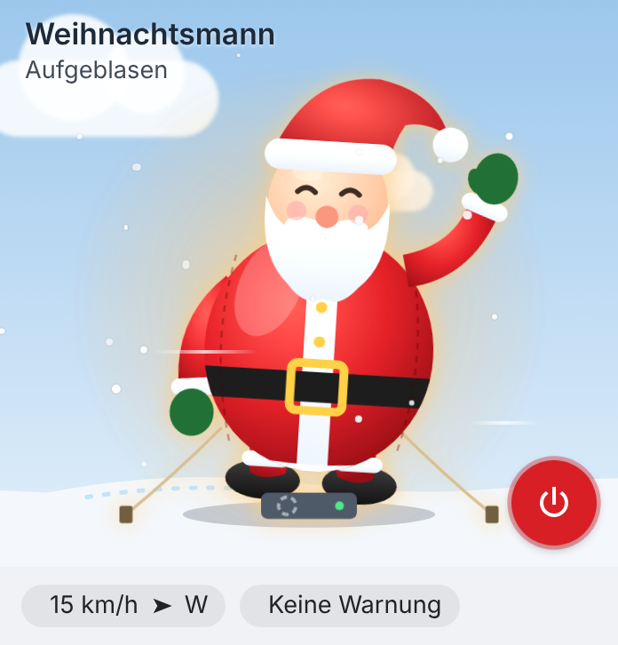
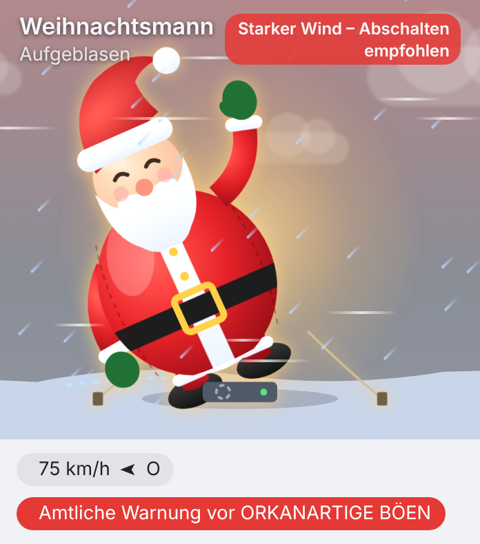
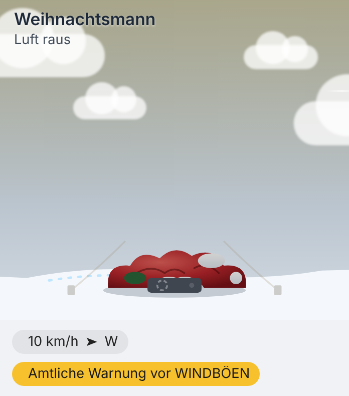
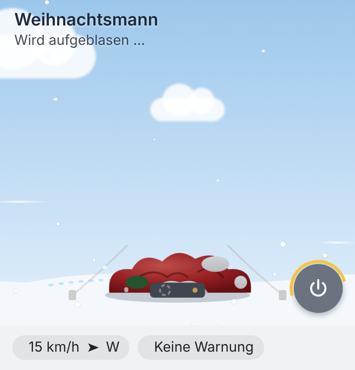
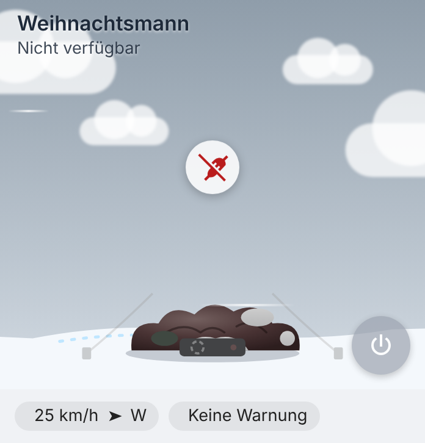

# 🎅 Inflatable Santa Card

[](https://hacs.xyz/docs/faq/custom_repositories)
[](https://github.com/Pfillip/inflatable-santa-card/actions/workflows/validate.yml)

Eine Lovelace-Karte für Home Assistant, die einen **beleuchteten, aufblasbaren Weihnachtsmann** darstellt und steuert.
Der Weihnachtsmann hängt an einer Schaltsteckdose: Schaltest du sie ein, bläst er sich animiert auf – schaltest du sie aus, sackt er langsam in sich zusammen.
Wind, Windrichtung, Wetter und die aktuelle **DWD-Warnstufe** fließen live in die Animation ein.

| Aufgeblasen bei Schnee | Nacht, Sturm & Gewitter | Luft raus |
| --- | --- | --- |
|  |  |  |

| Schaltet gerade (Button wartet auf die Steckdose) | Steckdose nicht verfügbar |
| --- | --- |
|  |  |

## Funktionen

- 🎈 **Aufblasen / Luft ablassen** – animiert, inklusive hängendem Kopf beim Aufpumpen und zusammengesacktem Haufen im ausgeschalteten Zustand
- 💡 **Beleuchtung** – warmes Leuchten, wenn die Steckdose eingeschaltet ist (nachts besonders schön), Gebläse mit Lüfter und Status-LED
- 🌬️ **Wind** – der Weihnachtsmann schwankt umso stärker, je mehr Wind weht, und neigt sich in Windrichtung; Mützenzipfel flattert, Windschlieren und Wolken ziehen passend zur Richtung
- 🌨️ **Wetter** – Schnee, Regen, Gewitter (Blitze), Nebel, Wolken, Sternenhimmel bei Nacht (über `sun.sun`), Raureif bei Frost
- ⚠️ **DWD-Warnungen** – farbige Warnstufe (gelb/orange/rot/violett) mit Überschrift; Warnungen wie Schneefall, Gewitter, Starkregen oder Nebel verstärken die Szene
- 🛑 **Sturmhinweis** – ab einer einstellbaren Windgeschwindigkeit erscheint „Starker Wind – Abschalten empfohlen“
- 🔴 **Eigener Ein/Aus-Button** – unten rechts; leuchtet rot, wenn der Weihnachtsmann an ist, zeigt einen Lade-Ring, solange die Steckdose noch nicht geantwortet hat, und wackelt kurz, wenn das Schalten fehlschlägt
- 🎬 **Alle Zustände animiert** – Aufblasen, Luft ablassen, „schaltet gerade“ (Gebläse läuft an, gelbe LED blinkt), „nicht verfügbar“ (grauer Haufen, rote LED, schwebendes Stecker-Symbol), Tag/Nacht-Wechsel, Wolken, Schnee, Regen, Nebel, Gewitter und Sturmhinweis blenden weich ein und aus, Wind und Warnfarbe ändern sich fließend
- 🖱️ **HA-Standard-Aktionen** – Antippen der Karte öffnet Details (`tap_action`), langes Drücken ebenso (`hold_action`), Doppeltippen frei belegbar; Tastatur-bedienbar. Ohne Button (`show_power_button: false`) schaltet das Antippen der Karte
- 🧩 **Visueller Editor** mit Entitäts-Auswahl, Aktionen-Editor und Darstellungsoptionen
- 📐 Unterstützt Masonry- und **Sections**-Dashboards, Deutsch & Englisch, `prefers-reduced-motion`

## Installation über HACS

1. HACS öffnen → oben rechts **⋮** → **Benutzerdefinierte Repositories**
2. Repository: `https://github.com/Pfillip/inflatable-santa-card`, Typ: **Dashboard** (bzw. „Lovelace“/„Plugin“)
3. „Inflatable Santa Card“ suchen und **Herunterladen**
4. Browser neu laden (ggf. Cache leeren)

HACS trägt die Ressource automatisch ein. Falls nicht: *Einstellungen → Dashboards → ⋮ → Ressourcen* →
`/hacsfiles/inflatable-santa-card/inflatable-santa-card.js` als **JavaScript-Modul**.

### Manuelle Installation

`dist/inflatable-santa-card.js` nach `config/www/` kopieren und als Ressource `/local/inflatable-santa-card.js` (JavaScript-Modul) hinzufügen.

## Konfiguration

Die Karte lässt sich komplett im visuellen Editor einrichten („Karte hinzufügen“ → „Inflatable Santa Card“). YAML-Beispiel:

```yaml
type: custom:inflatable-santa-card
entity: switch.weihnachtsmann_steckdose
name: Weihnachtsmann
wind_speed_entity: sensor.wetterstation_windgeschwindigkeit
wind_direction_entity: sensor.wetterstation_windrichtung
warning_entity: sensor.dwd_meine_stadt_current_warning_level
weather_entity: weather.forecast_home   # optional
storm_threshold: 50
view_direction: 0
```

| Option | Typ | Standard | Beschreibung |
| --- | --- | --- | --- |
| `entity` | Entität | **Pflicht** | Schaltsteckdose (`switch`, `input_boolean` oder `light`) |
| `name` | Text | Friendly Name | Angezeigter Name |
| `wind_speed_entity` | Sensor | – | Windgeschwindigkeit; km/h, m/s, mph und kn werden automatisch umgerechnet |
| `wind_direction_entity` | Sensor | – | Windrichtung (woher der Wind kommt) in Grad **oder** als Himmelsrichtung (`W`, `NO`, `SSW`, `Nordwest` …) |
| `warning_entity` | Sensor | – | DWD-Sensor „Aktuelle Warnstufe“ der Integration *Deutscher Wetterdienst (DWD) Weather Warnings* |
| `weather_entity` | Wetter | – | Optional für Schnee/Regen/Gewitter/Nebel/Wolken; liefert auch Wind, falls keine Wind-Sensoren gesetzt sind |
| `storm_threshold` | Zahl | `50` | Ab dieser Windgeschwindigkeit (km/h) erscheint der Sturmhinweis und der Weihnachtsmann zittert |
| `view_direction` | Zahl | `0` | Himmelsrichtung, in die du auf den Weihnachtsmann schaust (0 = Norden, 90 = Osten …). Damit passt die Neigung zur echten Situation im Garten |
| `show_name` | Bool | `true` | Name und Status oben links anzeigen |
| `show_info` | Bool | `true` | Infozeile mit Wind und Warnung anzeigen |
| `show_weather_effects` | Bool | `true` | Wettereffekte (Schnee, Regen, Blitze …) anzeigen |
| `show_power_button` | Bool | `true` | Eigenen Ein/Aus-Button anzeigen |
| `tap_action` | Aktion | `more-info` (ohne Button: `toggle`) | Standard-Aktion von Home Assistant |
| `hold_action` | Aktion | `more-info` | |
| `double_tap_action` | Aktion | `none` | |

**Tipp:** Ein Tipp auf die Wind- oder Warnungs-Chips öffnet direkt deren Detaildialog.

### DWD-Warnstufen

| Stufe | Bedeutung | Farbe |
| --- | --- | --- |
| 0 | keine Warnung | – |
| 1 | Wetterwarnung | gelb |
| 2 | markante Wetterwarnung | orange |
| 3 | Unwetterwarnung | rot |
| 4 | extreme Unwetterwarnung | violett |

## Entwicklung

```bash
npm install
npm run build      # erzeugt dist/inflatable-santa-card.js
npm run watch      # baut bei Änderungen neu
python3 -m http.server   # dann http://localhost:8000/demo/ öffnen
```

Unter `demo/` liegt eine Testseite mit simuliertem Home Assistant, auf der sich Schalter, Wind, Richtung, DWD-Stufe, Wetter und Nacht ausprobieren lassen.

### Release

Einen GitHub-Release (z. B. `v1.0.0`) anlegen – der Workflow baut die Karte und hängt `inflatable-santa-card.js` an den Release an. HACS installiert dann immer die Release-Datei.

---

## English

Animated, illuminated inflatable Santa for Home Assistant. Tap toggles the smart plug: Santa inflates or deflates with an animation. Wind speed and direction make him sway and lean, weather (snow, rain, thunderstorm, fog, night) and the German DWD warning level change the scene. Fully configurable through the visual editor. Install via HACS as a custom repository of type *Dashboard*.

Lizenz: MIT · Die Grafik ist eine eigene SVG-Zeichnung.
